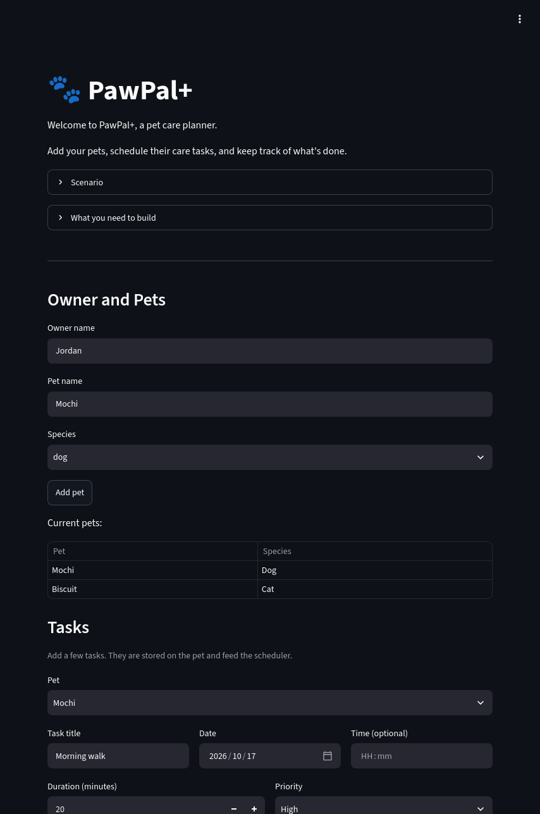
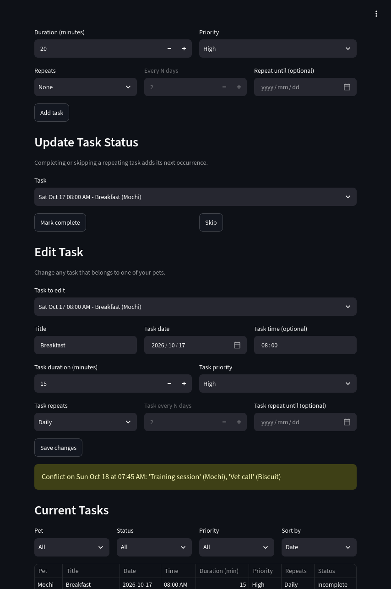
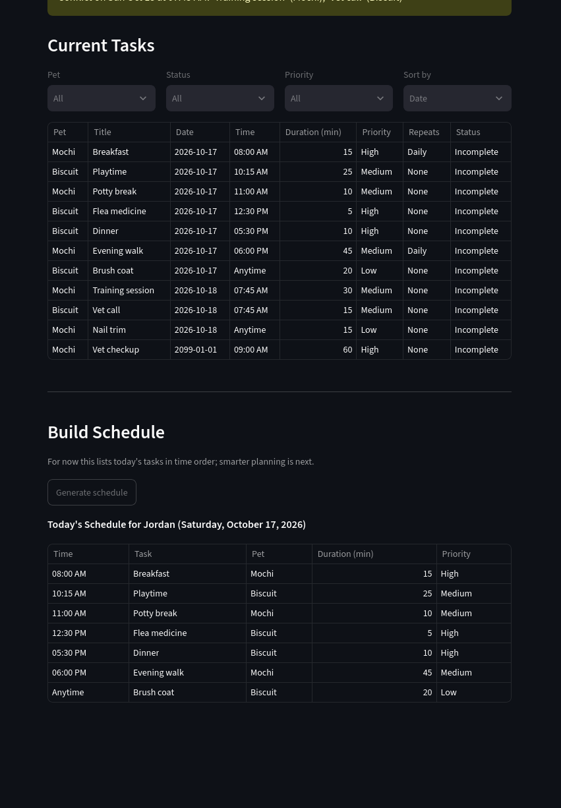
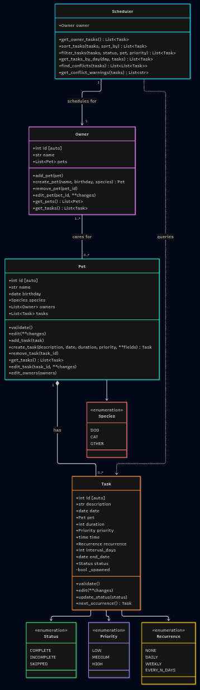

# PawPal+ (Module 2 Project)

You are building **PawPal+**, a Streamlit app that helps a pet owner plan care tasks for their pet.

## Scenario

A busy pet owner needs help staying consistent with pet care. They want an assistant that can:

- Track pet care tasks (walks, feeding, meds, enrichment, grooming, etc.)
- Consider constraints (time available, priority, owner preferences)
- Produce a daily plan and explain why it chose that plan

Your job is to design the system first (UML), then implement the logic in Python, then connect it to the Streamlit UI.

## What you will build

Your final app should:

- Let a user enter basic owner + pet info
- Let a user add/edit tasks (duration + priority at minimum)
- Generate a daily schedule/plan based on constraints and priorities
- Display the plan clearly (and ideally explain the reasoning)
- Include tests for the most important scheduling behaviors

## Getting started

### Setup

```bash
python -m venv .venv
source .venv/bin/activate  # Windows: .venv\Scripts\activate
pip install -r requirements.txt
```

### Suggested workflow

1. Read the scenario carefully and identify requirements and edge cases.
2. Draft a UML diagram (classes, attributes, methods, relationships).
3. Convert UML into Python class stubs (no logic yet).
4. Implement scheduling logic in small increments.
5. Add tests to verify key behaviors.
6. Connect your logic to the Streamlit UI in `app.py`.
7. Refine UML so it matches what you actually built.

## 🖥️ Sample Output

```
All tasks, in the order they were added
========================================================================
[ ] Sat Oct 17  06:00 PM  Evening walk      45 min  MEDIUM (Mochi, dog)
[ ] Sat Oct 17  08:00 AM  Breakfast         15 min  HIGH   (Mochi, dog)
[ ] Thu Jan 01  09:00 AM  Vet checkup       60 min  HIGH   (Mochi, dog)
[ ] Sun Oct 18  07:45 AM  Training session  30 min  MEDIUM (Mochi, dog)
[ ] Sat Oct 17  11:00 AM  Potty break       10 min  MEDIUM (Mochi, dog)
[ ] Sun Oct 18  Anytime   Nail trim         15 min  LOW    (Mochi, dog)
[ ] Sat Oct 17  12:30 PM  Flea medicine      5 min  HIGH   (Biscuit, cat)
[ ] Sat Oct 17  Anytime   Brush coat        20 min  LOW    (Biscuit, cat)
[ ] Sat Oct 17  05:30 PM  Dinner            10 min  HIGH   (Biscuit, cat)
[ ] Sat Oct 17  10:15 AM  Playtime          25 min  MEDIUM (Biscuit, cat)
[ ] Sun Oct 18  07:45 AM  Vet call          15 min  MEDIUM (Biscuit, cat)

Today's Schedule for Jordan (Saturday, October 17, 2026)
========================================================================
[ ] Sat Oct 17  08:00 AM  Breakfast         15 min  HIGH   (Mochi, dog)
[ ] Sat Oct 17  10:15 AM  Playtime          25 min  MEDIUM (Biscuit, cat)
[ ] Sat Oct 17  11:00 AM  Potty break       10 min  MEDIUM (Mochi, dog)
[ ] Sat Oct 17  12:30 PM  Flea medicine      5 min  HIGH   (Biscuit, cat)
[ ] Sat Oct 17  05:30 PM  Dinner            10 min  HIGH   (Biscuit, cat)
[ ] Sat Oct 17  06:00 PM  Evening walk      45 min  MEDIUM (Mochi, dog)
[ ] Sat Oct 17  Anytime   Brush coat        20 min  LOW    (Biscuit, cat)

Filtered by status: incomplete
========================================================================
[ ] Sat Oct 17  10:15 AM  Playtime          25 min  MEDIUM (Biscuit, cat)
[ ] Sat Oct 17  11:00 AM  Potty break       10 min  MEDIUM (Mochi, dog)
[ ] Sat Oct 17  12:30 PM  Flea medicine      5 min  HIGH   (Biscuit, cat)
[ ] Sat Oct 17  05:30 PM  Dinner            10 min  HIGH   (Biscuit, cat)
[ ] Sat Oct 17  06:00 PM  Evening walk      45 min  MEDIUM (Mochi, dog)
[ ] Sun Oct 18  07:45 AM  Training session  30 min  MEDIUM (Mochi, dog)
[ ] Sun Oct 18  07:45 AM  Vet call          15 min  MEDIUM (Biscuit, cat)
[ ] Sun Oct 18  08:00 AM  Breakfast         15 min  HIGH   (Mochi, dog)
[ ] Sun Oct 18  Anytime   Nail trim         15 min  LOW    (Mochi, dog)
[ ] Thu Jan 01  09:00 AM  Vet checkup       60 min  HIGH   (Mochi, dog)

Filtered by status: complete
========================================================================
[x] Sat Oct 17  08:00 AM  Breakfast         15 min  HIGH   (Mochi, dog)

Filtered by status: skipped
========================================================================
[-] Sat Oct 17  Anytime   Brush coat        20 min  LOW    (Biscuit, cat)

Filtered by pet: Mochi
========================================================================
[x] Sat Oct 17  08:00 AM  Breakfast         15 min  HIGH   (Mochi, dog)
[ ] Sat Oct 17  11:00 AM  Potty break       10 min  MEDIUM (Mochi, dog)
[ ] Sat Oct 17  06:00 PM  Evening walk      45 min  MEDIUM (Mochi, dog)
[ ] Sun Oct 18  07:45 AM  Training session  30 min  MEDIUM (Mochi, dog)
[ ] Sun Oct 18  08:00 AM  Breakfast         15 min  HIGH   (Mochi, dog)
[ ] Sun Oct 18  Anytime   Nail trim         15 min  LOW    (Mochi, dog)
[ ] Thu Jan 01  09:00 AM  Vet checkup       60 min  HIGH   (Mochi, dog)

Filtered by pet: Biscuit
========================================================================
[ ] Sat Oct 17  10:15 AM  Playtime          25 min  MEDIUM (Biscuit, cat)
[ ] Sat Oct 17  12:30 PM  Flea medicine      5 min  HIGH   (Biscuit, cat)
[ ] Sat Oct 17  05:30 PM  Dinner            10 min  HIGH   (Biscuit, cat)
[-] Sat Oct 17  Anytime   Brush coat        20 min  LOW    (Biscuit, cat)
[ ] Sun Oct 18  07:45 AM  Vet call          15 min  MEDIUM (Biscuit, cat)

Conflict check
========================================================================
WARNING: Conflict on Sun Oct 18 at 07:45 AM: 'Training session' (Mochi), 'Vet call' (Biscuit)
```

## Implementation Summary

An `Owner` can have 0 to many `Pet`. A `Pet` can have 0 to many `Task`.

When an `Owner` creates a new `Pet`, that `Pet` is added to the `Owner`'s list of `Pet`s. Removing the `Pet` removes it from the `Owner`'s list of `Pet`s. Editing the `Pet` is delegated to the `Pet` class, and is only accessible by a valid `Owner`.

An `Owner` can access their `Task`s via the list of `Task`s associated with each owned `Pet`.

## 🧪 Testing PawPal+

```sh
# Run the full test suite:
python -m pytest

# Run with coverage:
python -m pytest --cov
```

Sample test output:

```
=========================================== test session starts ===========================================
platform darwin -- Python 3.12.5, pytest-9.1.1, pluggy-1.7.0
rootdir: /Users/derickpalos/Documents/AI110/ai110-module2show-pawpal-starter
plugins: cov-7.1.0, anyio-4.15.1
collected 132 items                                                                                       

tests/test_pawpal.py .............................................................................. [ 59%]
......................................................                                              [100%]

=========================================== 132 passed in 0.15s ===========================================
```

```
=========================================== test session starts ===========================================
platform darwin -- Python 3.12.5, pytest-9.1.1, pluggy-1.7.0
rootdir: /Users/derickpalos/Documents/AI110/ai110-module2show-pawpal-starter
plugins: cov-7.1.0, anyio-4.15.1
collected 132 items                                                                                       

tests/test_pawpal.py .............................................................................. [ 59%]
......................................................                                              [100%]

============================================= tests coverage ==============================================
____________________________ coverage: platform darwin, python 3.12.5-final-0 _____________________________

Name                   Stmts   Miss  Cover
------------------------------------------
pawpal_system.py         208      0   100%
tests/test_pawpal.py     504      0   100%
------------------------------------------
TOTAL                    712      0   100%
=========================================== 132 passed in 0.43s ===========================================
```

Confidence Level: ⭐⭐⭐⭐

## 📐 Smarter Scheduling

| Feature | Method(s) | Notes |
|---------|-----------|-------|
| Task sorting | `Scheduler.sort_tasks`, `Scheduler.get_tasks_by_day` | Sort by `"date"` (then time), `"time"`, or `"priority"` (HIGH first). Untimed tasks come last, and ties keep their input order. A day's schedule is ordered by time, with priority breaking ties. |
| Filtering | `Scheduler.filter_tasks` | Filter by pet, status (incomplete, complete, skipped), and/or priority. Criteria combine with AND, and the result can be passed to `sort_tasks`. |
| Conflict handling | `Scheduler.find_conflicts`, `Scheduler.get_conflict_warnings` | Flags incomplete tasks that share a date and start time, for the same pet or different pets. Returns warning messages instead of raising. Durations aren't compared, so overlapping but differently-timed tasks aren't caught. |
| Recurring tasks | `Task.update_status`, `Task.next_occurrence`, `Recurrence` | Daily, weekly, or every N days, with an optional end date. Marking a recurring task complete or skipped creates the next occurrence once. The next date is based on the task's scheduled date, not the completion date. |

## 📸 Demo Walkthrough

Describe your app in numbered steps so a reader can follow along without watching a video:

1. Launch the PawPal+ app.
2. Add a Pet to an Owner.

    Fill out the form in the **Owner and Pets** section with an **Owner name**, a **Pet name**, and a **Pet Species**, and select **Add pet**.
    
    * A **Pet** is added to the **Owner** and appears in a **Current pets** table at the bottom of the **Owner and Pets** section.
    * This step is repeatable.

3. Add a Task to a Pet.

    Select a **Pet** from the list of available Pets. Add a **Task title**, **Date**, **Time** _(Optional)_, **Duration (minutes)**, **Priority**, and info for recurrence. Select **Add task**.

    * A **Task** is added to the **Pet** and appears in a **Current Tasks** section.
    * This step is repeatable.
    * The presence of **Task** that shares a start time with another **Task** will produce a Warning for a scheduling conflict.

4. In the **Build Schedule** section, select the **Generate schedule** button.

    * A table appears to show the scheduled Tasks.







## UML



## Features

- **Owner and pets:** Set the owner's name and add as many pets as you like, each with a name and species. Pets must be added before tasks.
- **Add tasks:** Choose a pet, then give the task a title, date, optional time, duration (1–240 minutes) and priority (Low, Medium or High). A confirmation message appears when the task is added.
- **Repeating tasks:** A task can repeat daily, weekly or every N days, optionally until a chosen end date.
- **Complete or skip tasks:** Mark an open task as complete or skipped. For a repeating task, the next occurrence is added automatically and the confirmation message names its date.
- **Edit tasks:** Change any task's title, date, time, duration, priority or repeat settings. A task's time can be changed but not cleared once set.
- **Filter and sort the task list:** Filter by pet, status or priority, and sort by date, time or priority. Tasks with no set time are listed last.
- **Conflict warnings:** The app warns when two open tasks, whether for the same pet or different pets, start at the same time on the same day. It shows "No scheduling conflicts" when there are none.
- **Today's schedule:** One button lists today's tasks in time order, with higher priority first when times match and untimed tasks last.